  

# 🏛️ Awesome Architectural Drawing & Schematic Automation

  
  
  
  
  
  

---

## 📌 Curated Architectural Drawing, Schematic Automation & Computational BIM Ecosystem

> **A comprehensive, SEO-optimized collection of enterprise SaaS platforms, open-source CAD/BIM engines, parametric technical drafting libraries, AI layout generators, and automated construction documentation pipelines.**

*Focused on Automated 2D Drafting, OpenBIM Collaboration (IFC), Parametric Schematics, Generative Floor Plans, CAD Scripting (Python/C++), and Algorithmic Space Planning.*

📅 **Last updated: November 2026**

This repository curates and indexes top **SaaS/hosted platforms** and **open-source developer repositories** for **Architectural Drawing & Schematic Automation**. These tools empower architects, structural engineers, computational designers, and AEC developers to automate, synthesize, validate, and deliver 2D architectural blueprints, construction schematics, parametric layouts, and Building Information Modeling (BIM) packages.

---

## 📑 Table of Contents

- [📊 Sector Overview & Market Dynamics](#-sector-overview--market-dynamics)
- [☁️ SaaS/Hosted Platforms](#️-saashosted-platforms)
- [💻 Open-Source GitHub Projects](#-open-source-github-projects)
  - [⭐ Featured Open-Source Repositories (Ranked by Stars)](#-featured-open-source-repositories-ranked-by-stars)
  - [🛠️ Specialized Frameworks & Custom Automation Pipelines](#️-specialized-frameworks--custom-automation-pipelines)
- [📈 Star History](#-star-history)
- [🤝 How to Contribute](#-how-to-contribute)
- [💖 Support & Sponsorship](#-support--sponsorship)
- [⚠️ Disclaimer](#️-disclaimer)

---

## 📊 Sector Overview & Market Dynamics

The global architectural design and BIM software sector is valued at approximately **$6.6B–$10B+** (with architectural CAD drafting accounting for ~$6.6B and broader BIM/AEC software scaling beyond $10B) growing at an 8%–12% CAGR. The market exhibits an **oligopolistic concentration at the top**—dominated by incumbent mega-vendors (Autodesk, Nemetschek, Trimble, and Hexagon) controlling standard enterprise formats and BIM mandates—paired with **moderate fragmentation across specialized niches**, where agile SaaS and point solutions compete on residential space planning, AI-assisted rendering, and lightweight browser drafting.

---

## ☁️ SaaS/Hosted Platforms

| Platform | Company Scale (Market Cap / Revenue / Valuation) | Pricing (Starting Tier) | Free Tier / Trial Limits | Description |
| :--- | :--- | :--- | :--- | :--- |
| **[AutoCAD Web (Autodesk)](https://autocad.com)** | ~$64.0B Market Cap / $6.13B FY25 Revenue | $10/month (or $100/year billed annually) | 30-day free trial; full web/mobile access with cloud DWG viewing & editing (no permanent free commercial plan; free access granted to verified educators & students). | Cloud-based CAD drafting platform enabling browser-native DWG editing, automated layer management, LISP scripting, and real-time architectural drawing collaboration. |
| **[Revit Cloud Worksharing (Autodesk BIM Collaborate Pro)](https://autodesk.com)** | ~$64.0B Market Cap / $6.13B FY25 Revenue | $78/month (or $925/year per user) | 30-day free trial; full cloud worksharing & model coordination access in Autodesk Construction Cloud across invited project team members. | Enterprise cloud BIM platform for multi-disciplinary architectural modeling, automated construction sheet generation, clash detection, and centralized model syncing. |
| **[BricsCAD BIM (Hexagon)](https://bricsys.com)** | ~$28.0B Market Cap / ~$5.5B Revenue | $1,166/year subscription (or $2,616 one-time perpetual) | 30-day free trial; unrestricted access to all BricsCAD Ultimate toolsets without watermarks; reverts to BricsCAD Shape after 30 days. | AI-assisted DWG-native BIM and CAD platform featuring automated spatial classification, continuous level-of-detail modeling, and automated 2D construction documentation. |
| **[SketchUp Web (Trimble)](https://sketchup.com)** | ~$12.8B Market Cap / ~$3.8B Revenue | $119/year (SketchUp Go starting tier) | Free forever plan (SketchUp Free); limited strictly to non-commercial use, browser-only interface, 10 GB Trimble Connect cloud storage, and basic SKP/STL import/export without plugin support. | Browser-based 3D architectural massing and schematic design environment integrated with Trimble Connect cloud storage and LayOut documentation workflows. |
| **[Vectorworks Cloud Services](https://vectorworks.net)** | ~$8.5B Market Cap / ~$1.4B Revenue (Nemetschek Group) | $108/month (Vectorworks Fundamentals starting tier; cloud services bundled with software) | Free forever account; includes 10 GB cloud storage, cloud drawing viewing, and Vectorworks Nomad mobile access for collaborators (expanded to 100 GB on paid licenses). | Cloud processing and collaboration suite offloading heavy 2D/3D architectural rendering, BIM file conversions, and automated drawing sheet publishing. |
| **[ArchiCAD BIMcloud (Graphisoft)](https://graphisoft.com)** | ~$8.5B Market Cap / ~$1.4B Revenue (Nemetschek Group) | $47/month per seat (or bundled with Archicad Collaborate) | Free forever on-premise tier (BIMcloud Basic) limited to self-hosted private hardware and basic per-project permissions; cloud-hosted BIMcloud SaaS requires a commercial license or promotional trial. | Real-time cloud BIM collaboration server powering simultaneous architectural drafting, automated schedule extraction, and cross-team model coordination. |
| **[Chief Architect Cloud](https://chiefarchitect.com)** | ~$10M–$17M Estimated Revenue (Privately held / Bootstrapped) | $229/month (or $1,995/year billed annually for Premier) | Unlimited duration free trial; strictly feature-restricted with save, print, and export capabilities disabled, alongside limited 3D library items. | Residential architectural drafting and automated construction drawing suite offering cloud plan sharing, 3D viewer links, and automated framing/elevation generation. |
| **[Cedreo](https://cedreo.com)** | ~$5M–$10M Estimated ARR (Privately held, acquired by SoftNext) | $59/month (or $39/month billed annually on Pro; $59 one-time per project) | Free forever plan; limited to 1 user, 1 project total, basic floor plan drafting, limited catalog items, and basic watermarked test renders. | Cloud-based 3D home design platform automating 2D dimensioned floor plans, cross-sections, and photorealistic architectural renderings for builders and remodelers. |
| **[Foyr Neo](https://foyr.com)** | ~$1M–$10M Estimated Revenue / ~$14M Total Venture Funding | $39/month (or $33/month billed annually on Basic) | 14-day free trial; no credit card required, includes trial access to 3D floor plan editor, standard 3D furniture catalog, and initial rendering quota. | Cloud-native architectural and interior layout platform combining automated 2D-to-3D plan conversion, AI-assisted lighting, and fast cloud rendering. |
| **[Floorplanner](https://floorplanner.com)** | Bootstrapped / Profitable (~$1M–$5M Estimated Revenue) | $5/month (Plus plan starting tier; Pro at $29/month) | Free forever plan (Basic); limited to 5 active projects, maximum 3 floors and 3 designs per project, SD-quality exports (960x540) with watermark, 10-minute export cooldown, and 0 monthly credits. | Interactive web-based 2D/3D schematic space-planning platform for rapid architectural floor plan drafting, automated measurements, and cloud sharing. |

---

## 💻 Open-Source GitHub Projects

### ⭐ Featured Open-Source Repositories (Ranked by Stars)

| Repository | GitHub_Stars_Badge | Primary Focus / Category | Description |
| :--- | :--- | :--- | :--- |
| **[tt-a1i/archify](https://github.com/tt-a1i/archify)** |  | Architectural Automation & Schematics | Open-source architectural drawing and schematic automation toolkit engineered to streamline architectural drafting, layout generation, and structured design workflows. |
| **[FreeCAD](https://github.com/FreeCAD/FreeCAD)** |  | 3D Parametric CAD & BIM Platform | Extensible parametric open-source 3D CAD/BIM modeler featuring automated 2D architectural drawing projections via TechDraw and deep Python scripting automation. |
| **[OpenSCAD](https://github.com/openscad/openscad)** |  | Programmatic CAD Modeling Compiler | The programmer's solid 3D CAD modeler; compiles human-readable code into 3D geometry and automated 2D architectural section projections and DXF/SVG schematics. |
| **[LibreCAD](https://github.com/LibreCAD/LibreCAD)** |  | 2D Computer-Aided Drafting | Mature open-source 2D CAD drafting suite supporting DXF blueprints, multi-layered architectural construction drawings, Hatch patterns, and coordinate automation. |
| **[CadQuery](https://github.com/CadQuery/cadquery)** |  | Python Parametric CAD Scripting | Python parametric CAD scripting framework based on OpenCascade B-Rep kernel; automates algorithmic drafting, building massing, and DXF/SVG drawing generation. |
| **[build123d](https://github.com/gumyr/build123d)** |  | Python Boundary-Representation CAD | Modern Python B-Rep modeling CAD framework for programmatic architectural components, structural framing, assembly generation, and automated 2D projection exports. |
| **[IfcOpenShell (Bonsai / BlenderBIM)](https://github.com/IfcOpenShell/IfcOpenShell)** |  | OpenBIM & Native IFC Documentation | Leading open-source library and ecosystem for Industry Foundation Classes (IFC); powers **Bonsai** for automated native BIM 2D drawing sheet generation and schedule extraction. |
| **[Sverchok](https://github.com/nortikin/sverchok)** |  | Parametric Visual Programming | Node-based parametric and generative architectural modeling suite inside Blender, facilitating algorithmic spatial layouts and complex façade schematics. |
| **[QCAD (Community Edition)](https://github.com/qcad/qcad)** |  | Scriptable 2D CAD Framework | Cross-platform 2D CAD application with an extensible ECMAScript (JavaScript) API for programmatic DXF/DWG/PDF architectural plan batch generation. |
| **[ezdxf](https://github.com/mozman/ezdxf)** |  | Python DXF Generation & Manipulation | High-performance Python package to read, write, audit, and automate DXF documents and technical drafting schematics across AutoCAD R12 through 2018+. |
| **[That Open Engine (web-ifc)](https://github.com/ThatOpen/engine_web-ifc)** |  | WebAssembly BIM Parsing Engine | Ultra-fast client-side WebAssembly IFC geometry processing engine capable of rendering and extracting 2D architectural plans and 3D models directly in web browsers. |
| **[Speckle Server & SDKs](https://github.com/specklesystems/speckle-server)** |  | Open-Source AEC Data Transport | The open-source data infrastructure platform for the AEC industry; automates real-time geometric model exchange and drawing syncing between CAD and BIM suites. |
| **[That Open Components](https://github.com/ThatOpen/engine_components)** |  | Modular BIM UI & Drafting Components | Modular open-source UI/UX and 3D/2D drawing component library built on Three.js and web-ifc for creating custom browser-based BIM tools. |
| **[CubiCasa5k](https://github.com/CubiCasa/CubiCasa5k)** |  | Computer Vision & Floor Plan Dataset | Large-scale dataset and deep learning baseline models for automated 2D floor plan image parsing, wall/room segmentation, and vector schematic extraction. |
| **[Hypar Elements](https://github.com/hypar-io/Elements)** |  | Generative Building Geometry (C#) | Cross-platform library for writing generative building design models, structural framing algorithms, and automated IFC/glTF geometry synthesis. |
| **[MeasureIt_ARCH](https://github.com/kevancress/MeasureIt_ARCH)** |  | Blender Dimensioning & Linework | Architectural documentation and precision dimensioning addon for Blender to automate technical annotations, dimension lines, and vector drawing outputs. |
| **[TopologicPy](https://github.com/wassimj/topologicpy)** |  | Spatial Topology & Graph Planning | Python library combining non-manifold topology, dual graphs, and spatial reasoning for generative architectural space planning and schematic graphs. |

---

### 🛠️ Specialized Frameworks & Custom Automation Pipelines

- 📦 **[IfcOpenShell + Bonsai](https://github.com/IfcOpenShell/IfcOpenShell)**: Build automated continuous-integration pipelines that validate architectural models against building regulations and compile IFC construction sheets without proprietary licenses.
- 📐 **[ezdxf + QCAD Scripting](https://github.com/mozman/ezdxf)**: Generate 2D dimensioned floor plans, HVAC schematics, electrical line layouts, and technical drawings programmatically using pure Python or JavaScript.
- 🌐 **[That Open Engine (web-ifc) + Three.js](https://github.com/ThatOpen/engine_web-ifc)**: Build proprietary browser-based architectural portals for real-time plan viewing, measurement tools, and automated SVG drawing downloads.
- 🔄 **[Speckle](https://github.com/specklesystems/speckle-server)**: Stream structural and architectural data between Rhino, Grasshopper, Revit, Blender, and Web browsers with automated version control.

---

## 📈 Star History

---

## 🤝 How to Contribute

Contributions, project suggestions, and documentation enhancements are warmly welcomed! 

1. 🍴 **Fork the repository** to your personal GitHub account.
2. 🌿 **Create a new branch** (`git checkout -b feature/awesome-cad-addition`).
3. 📝 **Add or update entries in `README.md`**:
   - Ensure open-source additions include active GitHub links and official Shields.io Stars_Badges (`style=social&color=white`) linking to the stargazers page.
   - For SaaS products, supply accurate pricing and specific free trial / free tier constraints in tabular format.
4. 🧪 **Check link validity** and ensure markdown formatting is clean and consistent.
5. 🚀 **Submit a Pull Request** with a concise description of your additions.

---

## 💖 Support & Sponsorship

If you find this curated collection useful for your architectural practice, computational design research, or drafting automation workflows, please consider supporting the project:

- ⭐ **Star this repository** to help other architects, engineers, and developers discover it!
- 🍴 **Fork and share** with colleagues in the AEC and open-source CAD/BIM community.
- ☕ **Buy a coffee & sponsor ongoing maintenance:**  
    
  Visit the [Sponsor Dashboard](https://github.com/sponsors/ishandutta2007) to support open-source developer tooling and curated AEC automation indexes.

---

## ⚠️ Disclaimer

- This is an **independently curated community list** and does not constitute a formal endorsement of any listed tool or platform.
- Architectural drawings, structural schematics, and BIM models produced via algorithmic scripts or generative AI workflows must be reviewed, verified, and stamped by an accredited, licensed architect or structural engineer prior to construction execution and regulatory submission.
- Ensure compliance with local building codes, IFC certification standards (buildingSMART IFC2x3, IFC4, IFC4.3), and software license agreements when implementing programmatic CAD systems.

---

  <b>Architectural Drawing & Schematic Automation Ecosystem</b> • Maintained by <a href="https://github.com/ishandutta2007">ishandutta2007</a>

